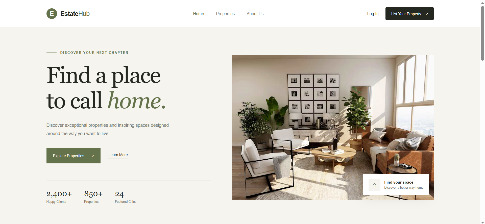
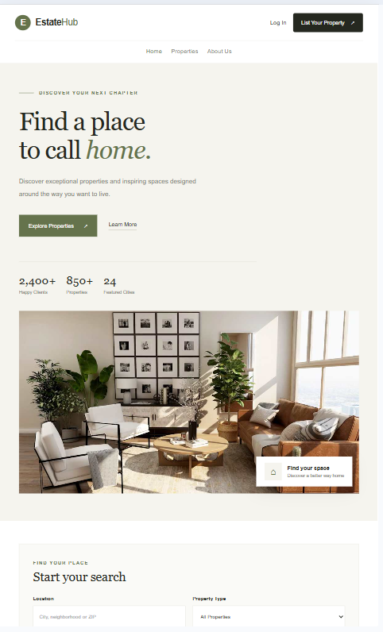
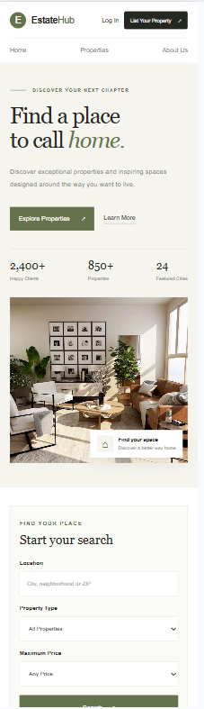

# EstateHub Pro

A modern, responsive real estate website built with HTML, CSS, and Vanilla JavaScript.

EstateHub Pro provides a clean and user-friendly interface for browsing, searching, filtering, and exploring property listings.

## Screenshots

### Desktop View



### Tablet View



### Mobile View


A responsive real estate platform designed to deliver a smooth browsing experience across desktop, tablet, and mobile devices.

## Features

- Responsive design for desktop, tablet, and mobile screens
- Dynamic property listings loaded from JSON
- Property search by location
- Filter properties by type and price range
- Sort properties by price
- Featured property listings
- Add and remove favorite properties
- Save favorite properties using Local Storage
- Detailed property information modal
- Property image gallery
- Fullscreen image viewer
- Keyboard navigation in the image gallery
- Contact Agent form interface
- Empty state when no properties match the filters
- Clean and modern user interface

## Technologies Used

- HTML5
- CSS3
- Vanilla JavaScript
- JSON
- Local Storage
- Visual Studio Code
- Live Server

## Project Structure

```text
EstateHub-Pro/
│
├── index.html
├── style.css
├── script.js
├── properties.json
├── README.md
│
└── images/
    ├── branding/
    ├── property-1/
    ├── property-2/
    ├── property-3/
    ├── property-4/
    ├── property-5/
    ├── property-6/
    ├── property-1.jpg
    ├── property-2.jpg
    ├── property-3.jpg
    ├── property-4.jpg
    ├── property-5.jpg
    ├── property-6.jpg
    └── hero.jpg.jpeg
```

## Getting Started

### 1. Clone the Repository

```bash
git clone YOUR_GITHUB_REPOSITORY_URL
```

### 2. Open the Project

```bash
cd EstateHub-Pro
```

### 3. Run the Project

Open the project folder in Visual Studio Code and run `index.html` using the Live Server extension.

The website will open in your browser.

## Data Source

Property information is stored in `properties.json` and loaded dynamically using JavaScript.

The current listings are sample/demo data for demonstration purposes.

## Browser Compatibility

Designed for modern browsers, including:

- Google Chrome
- Microsoft Edge
- Mozilla Firefox
- Safari

## Future Improvements

- User authentication
- Backend integration
- Database support
- Real property listings
- Advanced property search
- Online contact form integration
- Property submission dashboard

## Author

**Pouya Adineh**

Software Developer

## License

This project is available for portfolio and educational demonstration purposes.
